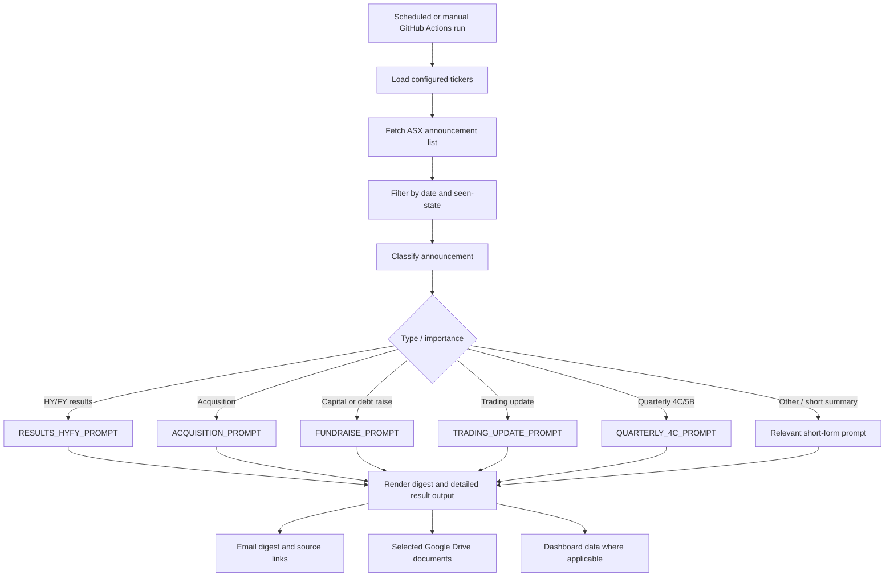

# Bob the Bot — ASX announcement intelligence

**In one sentence:** Bob checks ASX announcements for companies in the configured portfolio, decides what deserves attention, analyses selected documents, and sends a daily digest.

## What Bob does

**Confirmed in code/workflow**
- Reads the ASX ticker list from configuration (the main README identifies `tickers.yaml`).
- Fetches recent announcements and limits the normal scan to the last 24 hours.
- Tracks previously seen announcement IDs to avoid repeatedly reporting the same item; state is retained between runs.
- Retrieves documents when needed. The implementation tries direct HTTP first and has a Playwright browser fallback for ASX access restrictions.
- Uses Claude via the Anthropic API for AI analysis.
- Produces a digest organised into **HIGH IMPACT**, **MATERIAL** and **FYI** sections.
- Saves selected source documents/analysis to Google Drive and includes source links in the output.
- Has manual workflow inputs to force reruns, analyse non-portfolio tickers, or fetch the latest half/full-year results for a named ticker.

## Workflow

This diagram summarises the main routing; not every announcement goes through deep analysis. The code says deep analysis is reserved mainly for half/full-year results, acquisitions, and capital/debt raises, while other categories can receive shorter summaries or rule-based treatment.

## Where the instructions live

The prompt names below are Python constants in [`prompts.py`](../prompts.py), rather than separate Markdown skill files:

| Announcement type | Prompt constant |
|---|---|
| Half-year / full-year results | `RESULTS_HYFY_PROMPT` |
| Acquisition / merger / scheme | `ACQUISITION_PROMPT` |
| Equity raise, debt raise or refinancing | `FUNDRAISE_PROMPT` |
| Employee share plans / remuneration | `REMUNERATION_PROMPT` |
| Trading updates / guidance | `TRADING_UPDATE_PROMPT` |
| Quarterly cashflow / Appendix 4C or 5B | `QUARTERLY_4C_PROMPT` |
| Price-sensitive announcements | `PRICE_SENSITIVE_PROMPT` |
| General short summary | `DEFAULT_2LINE_PROMPT` |

For example, [`QUARTERLY_4C_PROMPT`](../prompts.py) tells the model to distinguish a real completed quarterly cashflow report from a notice that one will be released later, use a strict JSON output, and avoid inventing figures. The prompt’s output structure is a contract with the code that renders the result.

## Key files

- [`agent.py`](../agent.py) — orchestration: fetch, classify, route, analyse and assemble output.
- [`prompts.py`](../prompts.py) — model instructions and expected output structures.
- [`asx_fetch.py`](../asx_fetch.py), [`playwright_fetch.py`](../playwright_fetch.py), [`shared/asx.py`](../shared/asx.py) — announcement/document retrieval helpers.
- [`shared/pdf_llm.py`](../shared/pdf_llm.py) — preparing PDF documents for model analysis.
- [`shared/gdrive.py`](../shared/gdrive.py) — Drive integration.
- [`tickers.yaml`](../tickers.yaml) — monitored tickers, including market-specific sections.
- [`.github/workflows/daily.yml`](../.github/workflows/daily.yml) — scheduled and manual execution.

## Timing and manual controls

The workflow aims to deliver at **09:13 Sydney time**. Because GitHub cron is UTC-based and does not follow daylight saving, it uses several candidate cron times and lets the Python code decide whether to run or stand down. Singapore delivery time therefore shifts seasonally with Sydney time.

Manual controls include:
- **Force rerun tickers** — reprocess selected tickers even if seen.
- **Manual ticker** — analyse a ticker outside the normal portfolio list, within the workflow’s stated lookback.
- **Results ticker** — retrieve a ticker’s most recent half/full-year results with a longer lookback.

## Output and limitations

- The email is designed as a triage digest, not a replacement for reading source documents.
- For results, the workflow’s Claude notes say the email uses a compact metrics card and short summary, with longer analysis in a native Google Doc. Other announcement categories do not necessarily use that same output pattern.
- Fetch failures, blocked pages or missing source content can limit the analysis. A missing number should be reported as missing rather than guessed.
- Bob does not itself make trades. It produces research and alerts for a human to review.

## Source links

- [Main workflow](../.github/workflows/daily.yml)
- [Implementation](../agent.py)
- [Prompt library](../prompts.py)
- [Repository README](../README.md)
