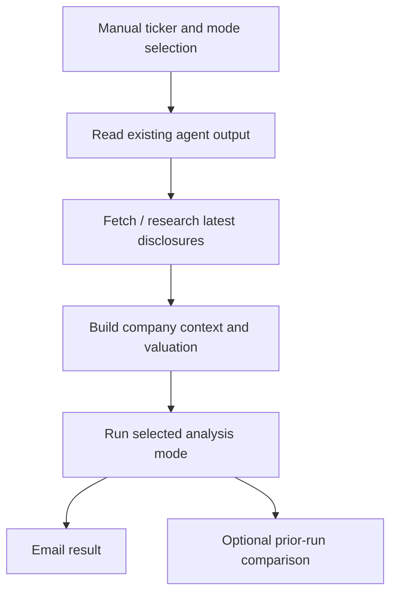

# Esther the Wrestler — narrative and valuation challenger

**In one sentence:** Esther is an on-demand analyst that reviews selected companies’ narratives and valuation, using the other agents’ existing output plus recent disclosures and the user’s chosen focus.

## Modes

The manual workflow supports five modes:
- **full** — full narrative review.
- **quick** — shorter update.
- **valuation** — change the valuation.
- **thesis** — check the thesis.
- **challenge** — explicitly challenge the thesis.

The user supplies ticker(s), can add a focus note, can override prices, and can provide ASX PDF links. Esther reads relevant Bob/Wally/Sally/Harry/Theo output already in the repository and researches recent disclosures using web search, then emails the result.

## Workflow

## Storage and scheduling

- Esther is **manual-only**; it does not run on a schedule in the inspected workflow.
- Prior-run comparison is retained in a private repository only if the optional private-store token is configured. Otherwise, the runner’s local copy is temporary.
- The workflow is read-only against the main repository.

## Key files

- [`esther/main.py`](../esther/main.py) — orchestration.
- [`esther/analyst.py`](../esther/analyst.py), [`esther/prompts.py`](../esther/prompts.py) — analysis and model instructions.
- [`esther/valuation.py`](../esther/valuation.py) and [`esther/quality.py`](../esther/quality.py) — valuation/quality logic.
- [Workflow](../.github/workflows/esther.yml)

## Best use

Use Esther when a company needs a focused, deliberate review rather than waiting for a routine digest. The `challenge` mode is the most direct way to ask whether the thesis is still supported. Treat its answer as analysis to verify, not as an independent source of truth: it can only be as good as the disclosures, assumptions and context it receives.
