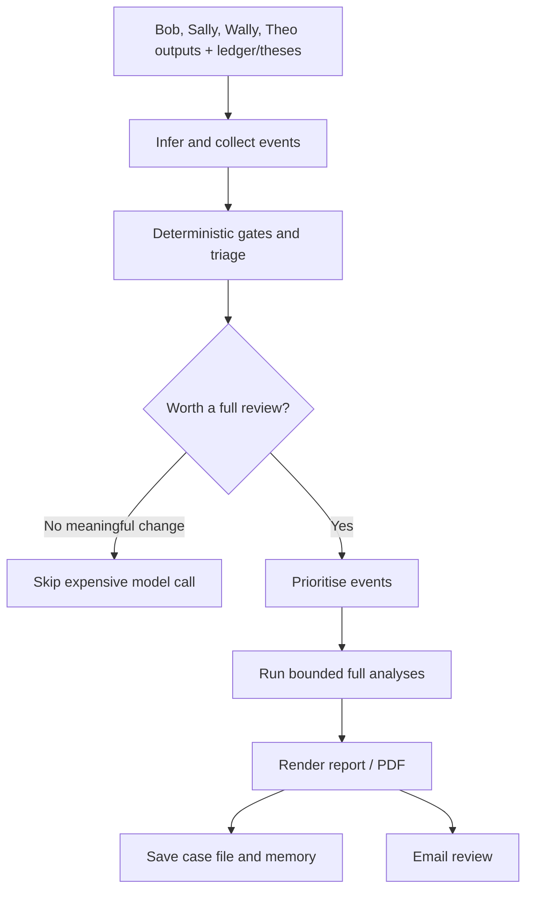

# Harry / Captain Hindsight — the chief sceptic

**In one sentence:** Harry reviews investment decisions and portfolio events to challenge the reasoning, identify behavioural risks, and ask whether the thesis or the evidence has changed.

## What Harry does

The code’s stated design is to collect events from existing agent outputs and portfolio/thesis records, apply deterministic gates first, and only spend model calls when a gate fires. It is designed to challenge decisions rather than simply repeat news.

The run can infer activity from the ledger and ticker configuration, collect Bob high-impact events, Sally sell signals, Wally top opportunities, due autopsies and portfolio-review events, triage events, then perform full analyses in priority order up to a call cap. Lower-priority work can be queued for later.

Harry’s framework files include:
- Annie Duke-style bet/decision thinking.
- Munger tendencies / behavioural biases.
- Seven Powers as a business-quality diagnostic.

## Workflow

## Current trigger status matters

**Confirmed in workflow:** automatic triggering from Bob/Wally/Sally completion is commented out/disabled as of the workflow’s own 10 October 2026 note. Harry is still available through manual `workflow_dispatch`, with modes including:
- `daily` — triage plus events
- `sell` — review a named holding
- `sweep` — review every holding with a thesis
- `portfolio`
- `autopsy`
- `scorecard`

Do not assume Harry runs automatically every time another bot finishes; the current workflow explicitly says that behaviour was disabled pending a decision on what the automatic run should cover.

## Memory and privacy

The default case-file/memory store is local to the workflow and carried between runs through the Actions cache in `hindsight_data/` (gitignored). An older private-repository store is still available as an option. Holdings and thesis inputs come from repository data and thesis files. Public dashboard outputs are separate from private case files.

## Key files

- [`hindsight/runner.py`](../hindsight/runner.py) — orchestration and event order.
- [`hindsight/gating.py`](../hindsight/gating.py) — gates and prioritisation inputs.
- [`hindsight/prompts.py`](../hindsight/prompts.py) — triage, analysis and autopsy instructions.
- [`hindsight/frameworks/`](../hindsight/frameworks) — decision and behavioural frameworks.
- [`hindsight/store.py`](../hindsight/store.py) — persistent case store interface.
- [`.github/workflows/captain_hindsight.yml`](../.github/workflows/captain_hindsight.yml) — current trigger and run modes.

## What Harry is not

Harry is not an automated sell button. It generates challenges, reviews and evidence-led questions for a human investor. A warning is a prompt to reconsider, not proof that the original decision was wrong.
