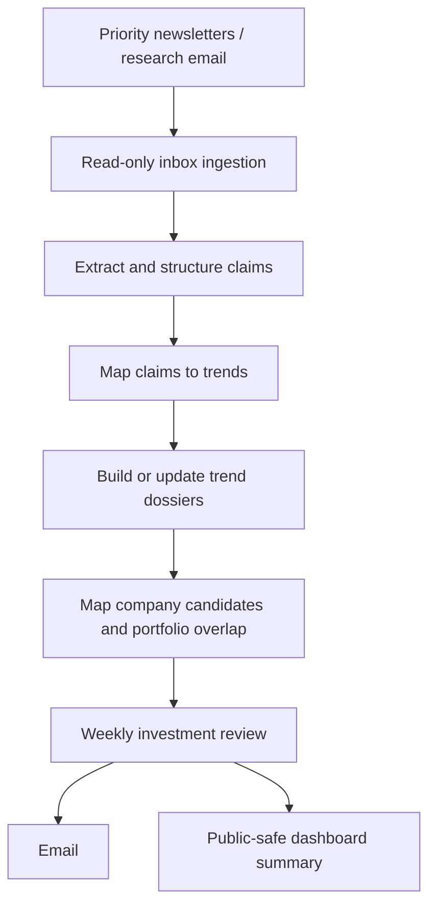

# Micky’s Macro — structural trends and investment research

**In one sentence:** Micky’s Macro turns selected research newsletters into structured claims, trend dossiers and company candidates, then produces a weekly investment-intelligence review.

## What it does

**Confirmed in the workflow and package**
- Reads configured priority research sources from Gmail over read-only IMAP.
- Extracts claims and maps them to trends and possible companies.
- Maintains dossiers and trend mappings between runs.
- Can assess overlap with Wally watchlists/portfolio candidates.
- Produces a weekly Macro Investment Review and a public-safe dashboard summary.
- Supports manual modes: `incremental`, `backfill`, `daily` and `weekly`; a no-email option allows ingestion and dashboard work without sending a report.
- Stores detailed research data in a gitignored local data directory carried between GitHub Actions runs through cache. Only the public-safe summary is committed to the repository.

## Workflow

## Timing

The scheduled workflow runs **weekly on Sunday at 08:00 Singapore time**, sharing the UTC slot with Sally and Shorty. This is a weekly research batch, not a daily news digest.

## Key files

- [`mickys_macro/main.py`](../mickys_macro/main.py) — orchestration.
- [`mickys_macro/gmail_ingest.py`](../mickys_macro/gmail_ingest.py) — inbox ingestion.
- [`mickys_macro/claim_extraction.py`](../mickys_macro/claim_extraction.py) — claim extraction.
- [`mickys_macro/trend_mapping.py`](../mickys_macro/trend_mapping.py) and [`company_mapping.py`](../mickys_macro/company_mapping.py) — mapping.
- [`mickys_macro/scoring.py`](../mickys_macro/scoring.py) — scoring.
- [`config/macro_sources.yaml`](../config/macro_sources.yaml) and [`config/macro_taxonomy.yaml`](../config/macro_taxonomy.yaml) — sources and taxonomy.
- [Architecture note](../docs/MICKYS_MACRO_ARCHITECTURE.md) · [Workflow](../.github/workflows/mickys_macro.yml)

## Limits

This is a research discovery and synthesis process. A trend dossier is a hypothesis to investigate, not proof that a listed company will benefit or that its shares are attractively priced. Follow the source trail and verify the original claim before relying on it.
