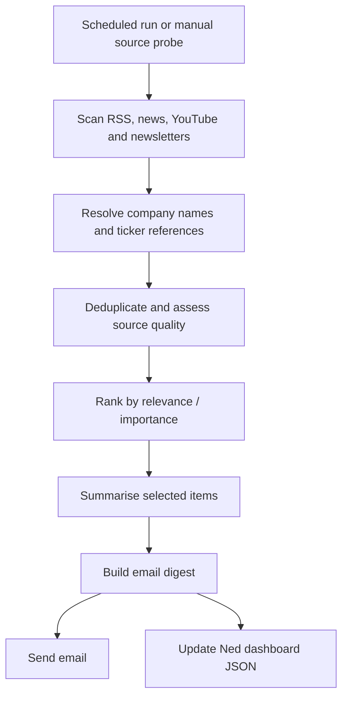

# Ned — news, newsletter and media scanner

**In one sentence:** Ned searches a configured set of news and media sources for information relevant to portfolio companies, ranks the hits, removes duplicates/noisy sources, and sends a digest.

## What Ned scans

The code documents these source types:
- YouTube channels, using the YouTube Data API and transcript tooling.
- Google News RSS feeds for companies.
- Static RSS feeds, including financial-media sources.
- Yahoo Finance news.
- Email newsletters received in an inbox, accessed using read-only IMAP.
- Podcast and video transcripts, with separate workflows for transcript-focused runs.

The sources and channels are configured in [`media_sources.yaml`](../media_sources.yaml), with portfolio/company context drawn from the repository’s ticker configuration and company-entity mapping.

## How it works

**Confirmed in code:** source quality is tiered. Low-quality “AI rewrite mill” sources are capped at low importance, skip LLM summaries, and are collapsed into a single line rather than crowding the main digest. The agent also tracks seen items between runs to reduce repeat reporting.

## Timing and controls

The main Ned News Agent runs daily at **07:30 Singapore time**. A manual **probe-only** option checks whether configured sources respond without sending an email or updating state. Other workflows handle podcasts, transcript digests and video-related material separately; see [supporting workflows](supporting-workflows.md).

Automatic runs may use Anthropic Message Batches, while manual runs use direct model calls for faster feedback. A configured wait/fallback prevents an unfinished batch from silently meaning fewer answers.

## Key files

- [`ned/main.py`](../ned/main.py) — main orchestration.
- [`ned/news_scanner.py`](../ned/news_scanner.py) — RSS/news scanning.
- [`ned/newsletter_scanner.py`](../ned/newsletter_scanner.py) — read-only newsletter ingestion.
- [`ned/youtube_scanner.py`](../ned/youtube_scanner.py) and transcript fetchers — video/media content.
- [`ned/source_quality.py`](../ned/source_quality.py) — source tiers and duplicate handling.
- [`ned/importance_scorer.py`](../ned/importance_scorer.py) — ordering/prioritisation.
- [`ned/email_builder.py`](../ned/email_builder.py) — digest rendering.
- [`.github/workflows/ned_news.yml`](../.github/workflows/ned_news.yml) — daily workflow.

## Limits

Ned is only as broad as its configured sources and entity matching. A missed company alias, broken feed, missing transcript or inaccessible newsletter can mean a relevant item is not surfaced. The digest is a discovery layer; verify important claims against the original source.
