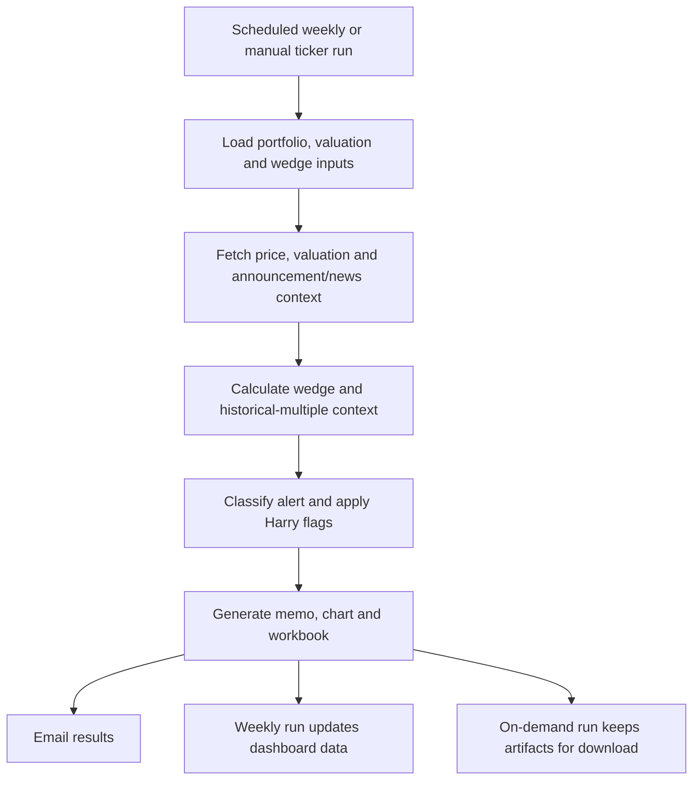

# Sally / Selling Sally — valuation wedge and sell discipline

**In one sentence:** Sally compares market price with an estimated value range and historical valuation context, then highlights whether a holding may be approaching a buy/sell zone or deserves a deeper review.

## What Sally does

**Confirmed in code**
- Loads the portfolio and valuation inputs, retrieves current price/valuation data and relevant announcements, and builds a value wedge.
- Analyses where price sits relative to the wedge and whether a move appears to come from earnings or from the valuation multiple.
- Uses historical valuation multiples and price data to put current conditions in context.
- Classifies alerts and applies Harry flags where configured.
- Produces a written memo, chart(s), and a workbook/reporting artifacts; selected outputs are emailed and the scheduled run updates dashboard data.
- Has a manual on-demand workflow for named tickers that does not update the weekly dashboard JSON or upload to Drive.

## Workflow

## Timing and controls

- Weekly review runs **Sunday at 08:00 Singapore time**.
- The manual **Sally Wedge Check** accepts one or more tickers and a chart start point: full history, one year before the first buy in the ledger, or a specified date.
- The manual run is intentionally separate from the weekly dashboard update.

## Key files

- [`sunday-sally/src/main.py`](../sunday-sally/src/main.py) — orchestration.
- [`sunday-sally/src/value_wedge.py`](../sunday-sally/src/value_wedge.py) — wedge calculations.
- [`sunday-sally/src/alert_engine.py`](../sunday-sally/src/alert_engine.py) — alert classification and verdict logic.
- [`sunday-sally/src/historical_multiple_analyzer.py`](../sunday-sally/src/historical_multiple_analyzer.py) — historical multiple context.
- [`sunday-sally/src/valuation_engine.py`](../sunday-sally/src/valuation_engine.py) — valuation data.
- [Weekly workflow](../.github/workflows/sunday_sally_weekly_review.yml) · [Manual workflow](../.github/workflows/sally_wedge.yml)

## How to interpret the output

A wedge is an estimate based on assumptions and source data, not a precise intrinsic-value measurement. The output is intended to focus attention and force a price-versus-value conversation. Check the thesis, the assumptions, the latest company disclosures and the reason the multiple changed before treating an alert as a decision.
