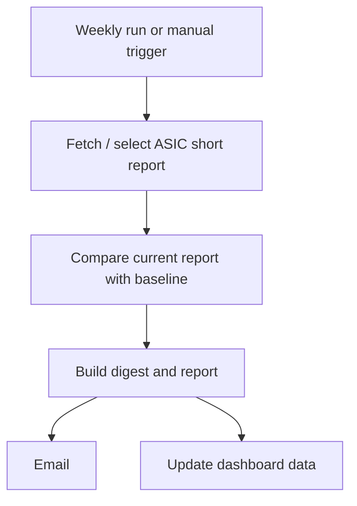

# Shorty — short-interest monitoring

**In one sentence:** Shorty turns ASIC short-position reports into a weekly digest so changes in reported short interest are easier to spot.

## What it does

**Confirmed in workflow**
- Runs weekly, using the latest ASIC report by default.
- Supports overriding the report date and the baseline date used for comparison.
- Builds a digest and PDF-style report, emails the result, and updates dashboard data.
- Has a dry-run option to build and preview the output without sending email or committing a dashboard update.

## Workflow

## Timing and controls

The scheduled run is **Sunday at 08:00 Singapore time**, the same UTC slot as Sally and Micky’s Macro. The report’s date and baseline can be overridden for a specific investigation.

## Key files

- [`shorty_agent.py`](../shorty_agent.py) — main processing.
- [`shorty_fetch.py`](../shorty_fetch.py) — report retrieval.
- [`shorty_pdf.py`](../shorty_pdf.py) and [`shorty_email.py`](../shorty_email.py) — output.
- [Workflow](../.github/workflows/shorty_report.yml)

## Interpretation

Reported short interest is one signal about positioning and potential market pressure. It does not by itself establish that a company is overvalued or that a short position is correct. Look at the direction, size and persistence of the change alongside price action, liquidity, catalysts and the company’s fundamentals.
