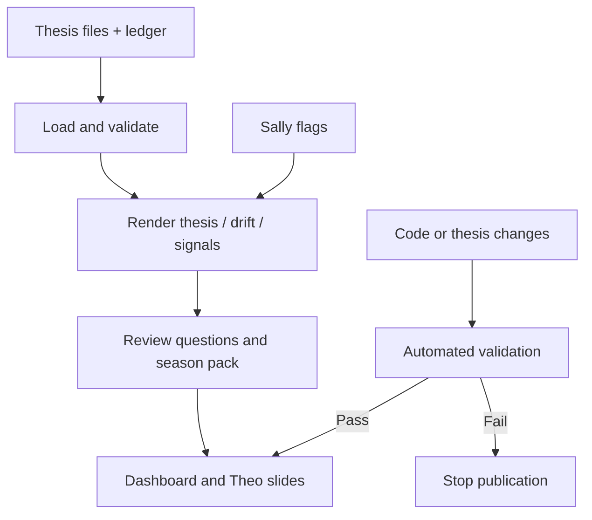

# Theo — thesis records, review cycles and thesis drift

**In one sentence:** Theo is the structured home for investment theses and related review tools; it helps make the thesis explicit, track changes and prepare reviews rather than relying on memory.

## What Theo does

**Confirmed in code/workflows**
- Loads thesis files and an investment ledger.
- Checks thesis structure and can fail a CI run if a thesis is malformed.
- Renders thesis views and supports commands for listing, showing, publishing, drift checks, signals and seasonal review packs.
- Tracks thesis/decision-quality signals and consumes Sally’s dashboard output as an input to follow-up questions.
- Builds a pre-results review pack ahead of the main ASX reporting seasons.
- Publishes a dashboard and Theo slides together through a single Pages workflow; this avoids one deployment replacing the other.

## Typical flow

## When it runs

- The Pages workflow responds to relevant pushes and to completion of selected agent workflows so updated agent data gets published.
- The season-pack workflow runs on **1 January and 1 July UTC** (roughly a month before the main February/August reporting seasons) and can also be started manually.
- Manual season-pack inputs can override the date and optionally include amounts. Public-output rules still apply to anything published.

## Key files

- [`theo/cli.py`](../theo/cli.py) — command-line interface.
- [`THEO.md`](../THEO.md) — user-facing Theo notes.
- [`config/theo_business_quality.yaml`](../config/theo_business_quality.yaml) and [`config/theo_decision_quality.yaml`](../config/theo_decision_quality.yaml) — configuration.
- [`theo-pages.yml`](../.github/workflows/theo-pages.yml) — single site publisher.
- [`theo-season.yml`](../.github/workflows/theo-season.yml) — pre-season pack.
- [`docs/VALUATION_RULES.md`](../docs/VALUATION_RULES.md) — valuation rule notes.

## Why this matters

A thesis should state what must be true for the investment to work, what evidence would weaken it, and what would change your mind. Theo’s structured records and drift/review commands make those conditions inspectable. The tool can make a thesis more explicit; it cannot make a weak thesis correct merely by recording it.
