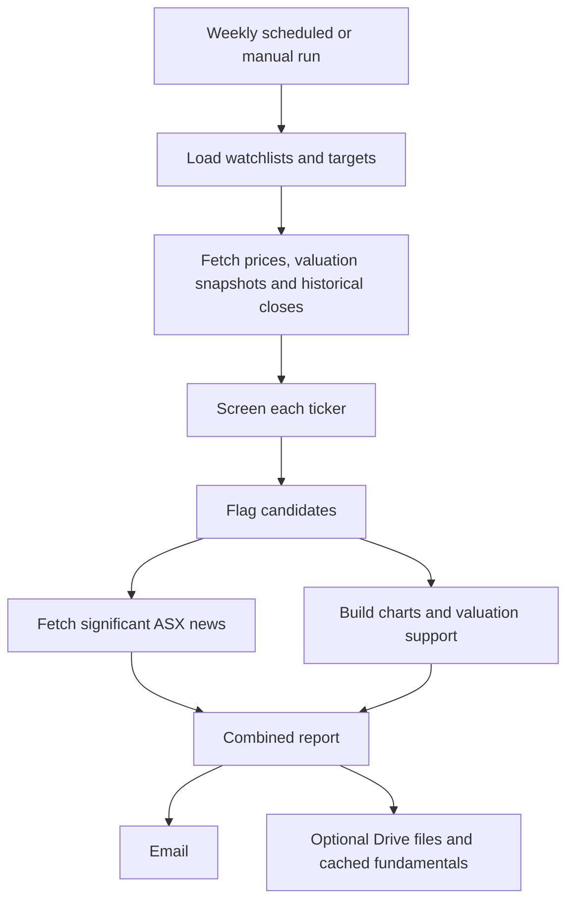

# Wally — watchlist and valuation screening

**In one sentence:** Wally runs configured watchlists through price/valuation screens, flags names that merit attention, and packages the results with relevant news and supporting charts/workbooks.

## What Wally does

**Confirmed in code**
- Runs configured watchlists; the scheduled workflow calls the combined run and includes the TII75 watchlist.
- Pulls price snapshots, valuation snapshots and long historical closes.
- Screens for conditions such as a share price being near a multi-year low and compares the result with configured portfolio targets.
- Looks for significant ASX announcements for flagged names.
- Builds charts and email reports; it can also produce Excel valuation workbooks and upload files to Google Drive when those optional components are available.
- Uses a combined email report for all watchlists rather than sending one email per list.
- Maintains/updates a fundamentals cache and can synchronise valuation archetypes.

## Workflow

## Timing and run modes

The workflow schedules Wally for **Saturday morning Singapore time** (Friday 22:30 UTC). A manual run is also available. Automatic runs may use Anthropic Message Batches to reduce cost; manual runs use direct calls so results return immediately. The workflow includes a fallback for batch responses that do not arrive within its configured wait.

## Key files

- [`wally/main.py`](../wally/main.py) — main orchestrator.
- [`wally/screening.py`](../wally/screening.py) — screening logic.
- [`wally/data_fetch.py`](../wally/data_fetch.py) — market/valuation data retrieval.
- [`wally/config.py`](../wally/config.py) and [`config/watchlists.yaml`](../config/watchlists.yaml) — watchlists and screening configuration.
- [`config/jm_portfolio_targets.yaml`](../config/jm_portfolio_targets.yaml) and related target files — valuation/portfolio reference inputs.
- [`.github/workflows/wally_watchlists.yml`](../.github/workflows/wally_watchlists.yml) — scheduling and execution.

## What Wally is not

Wally is a screening and opportunity-finding process, not a final investment decision. A flag means “look closer,” not “buy.” Its usefulness depends on the quality and freshness of the market data and the assumptions/targets used in the screen.
