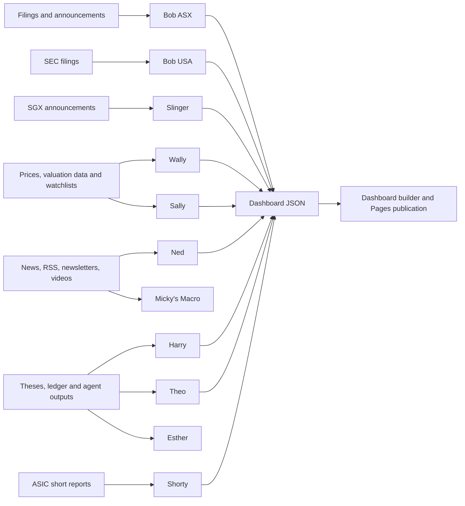

# Agent workflow matrix

This document maps each agent from input to delivery. It is based on the repository's current implementation, prompt modules, workflow YAML and existing agent documentation. It is intended as an operational map, not a claim that every agent invokes every other agent.

**Column meanings**
- **Inputs / source** — the files, feeds, reports or upstream artifacts read by the workflow.
- **Processing** — deterministic code and analysis stages.
- **Prompts / tools** — prompt modules and external services or libraries visible in the implementation. Shared model transport is documented in [infrastructure](../docs/INFRASTRUCTURE.md); exact model choice can vary by agent/workflow configuration.
- **Outputs / destination** — email, files, dashboard JSON, artifacts or persistent state.

## End-to-end flow

The arrows are conceptual. Actual dependencies and triggers are defined in each workflow; several agents run independently.

## Main agent matrix

| Agent | Inputs and where they come from | What it does | Prompts, model calls and tools | Outputs / destination |
|---|---|---|---|---|
| **Bob the Bot — ASX** | Portfolio tickers in [`tickers.yaml`](../tickers.yaml); ASX announcement feed and announcement/PDF URLs; seen-announcement state; optional manual workflow inputs for ticker overrides, forced reruns and results lookback. | Fetches recent announcements; filters by date and dedup state; classifies document type and importance; downloads PDFs with direct HTTP then browser fallback where needed; extracts and validates text; uses short summaries for routine items and deeper analysis for selected material event types. | [`prompts.py`](../prompts.py) contains structured JSON prompts including quick summaries and document-specific analysis. Uses shared ASX/PDF helpers, Requests, Playwright fallback, PDF text extraction, shared LLM/PDF transport, email and Google Drive integrations. | Daily HIGH IMPACT / MATERIAL / FYI email; selected reports and analysis saved to Drive; [`docs/data/bob.json`](../docs/data/bob.json); seen-state file. Workflow: [`daily.yml`](../.github/workflows/daily.yml). |
| **Bob USA** | US ticker configuration in [`tickers.yaml`](../tickers.yaml); SEC EDGAR filing data; filing accession IDs and manual ticker/dry-run inputs. | Finds new configured-company filings, filters previously seen accessions, prepares filing text and analyses relevant filings, then creates a regional digest. | [`us_agent.py`](../us_agent.py) orchestrates the standalone US pipeline; shared LLM/PDF and email helpers where imported. SEC EDGAR is the source; it does not reuse Bob's ASX orchestrator. | Digest and [`docs/data/us.json`](../docs/data/us.json); seen-state [`state_seen_us.json`](../state_seen_us.json). Workflow: [`us_daily.yml`](../.github/workflows/us_daily.yml). |
| **Singapore Slinger** | Configured SGX tickers/market configuration; SGX announcement endpoint; per-run lookback/ticker override/fetch-only/results inputs; own seen-state. | Retrieves SGX announcements, classifies them, analyses relevant results and material items, then builds a digest. Kept separate from ASX because retrieval/runtime requirements differ. | [`sgx_agent.py`](../sgx_agent.py), [`sgx_fetch.py`](../sgx_fetch.py), [`sgx_classify.py`](../sgx_classify.py), [`sgx_email.py`]; shared PDF/LLM helpers. Uses the self-hosted Windows runner for SGX access constraints. | Email and [`docs/data/slinger.json`](../docs/data/slinger.json); `state_seen_sgx.json`. Workflow: [`sgx_daily.yml`](../.github/workflows/sgx_daily.yml). |
| **Wally** | YAML watchlists under [`watchlists/`](../watchlists/) and [`config/watchlists.yaml`](../config/watchlists.yaml); valuation/portfolio targets under [`config/`](../config/); current and historical market prices, valuation snapshots and significant ASX announcements. | Loads and de-duplicates watchlists; screens price/valuation conditions (including near-lows and configured target comparisons); enriches flagged names with announcement context; creates charts and supporting valuation material. | [`wally/main.py`](../wally/main.py), [`wally/screening.py`](../wally/screening.py), [`wally/data_fetch.py`](../wally/data_fetch.py); EODHD/market-data helpers, announcement fetchers, chart/workbook generation and shared email/Drive utilities. Model analysis is used where the implementation requests it; the screening gates are code-based. | Combined watchlist email, reports/workbooks under outputs, optional Drive artifacts, fundamentals cache, [`docs/data/wally.json`](../docs/data/wally.json). Workflow: [`wally_watchlists.yml`](../.github/workflows/wally_watchlists.yml). |
| **Selling Sally** | Portfolio/ledger, valuation inputs and wedge configuration; current and historical price/valuation data; relevant announcements/news; Harry flags where configured. | Calculates price-versus-value wedge and historical multiple context; analyses whether price moves reflect earnings or multiple changes; classifies alert/verdict and prepares a review memo and visuals. | [`sunday-sally/src/main.py`](../sunday-sally/src/main.py), `value_wedge.py`, `alert_engine.py`, `historical_multiple_analyzer.py`, `valuation_engine.py`; shared data/model/email helpers. The prompt/output parser expects a verdict/bull-case style structure. | Weekly email, memo/charts/workbook and [`docs/data/sally.json`](../docs/data/sally.json). Manual wedge-check workflow creates on-demand artifacts without updating the weekly dashboard JSON. Workflows: [weekly](../.github/workflows/sunday_sally_weekly_review.yml) and [manual](../.github/workflows/sally_wedge.yml). |
| **Ned** | [`media_sources.yaml`](../media_sources.yaml); ticker/company entity mapping and portfolio context; YouTube channels/transcripts, Google News RSS, static RSS, Yahoo Finance news and newsletter emails read through IMAP. Separate podcast/video/transcript workflow inputs. | Scans sources, resolves company/ticker references, deduplicates items, applies source-quality and importance scoring, summarises selected hits, and assembles digests. Low-quality rewrite-mill sources are capped and may skip LLM summaries. | [`ned/main.py`](../ned/main.py), `news_scanner.py`, `newsletter_scanner.py`, `youtube_scanner.py`, `source_quality.py`, `importance_scorer.py`, `email_builder.py`; RSS/IMAP/YouTube/transcript tools and shared model/email helpers. | Email digest and [`docs/data/ned.json`](../docs/data/ned.json); transcript state/data files. Workflows: [news](../.github/workflows/ned_news.yml), [podcast](../.github/workflows/ned_podcast.yml), [transcript](../.github/workflows/ned_transcript.yml), and [Ausbiz video](../.github/workflows/ned_ausbiz_video.yml). |
| **Micky's Macro** | Configured macro/newsletter sources in [`config/macro_sources.yaml`](../config/macro_sources.yaml); research newsletters ingested from a mailbox via read-only IMAP; macro/source configuration and prior dossiers/candidates. | Converts research into structured source notes, structural-trend dossiers and company candidates, with an emphasis on evidence and traceability from source to idea. | [`mickys_macro/main.py`](../mickys_macro/main.py) and its ingestion, dossier and candidate modules; IMAP, YAML configuration, shared LLM transport and email/report utilities. See [macro architecture](../docs/MICKYS_MACRO_ARCHITECTURE.md) for implementation-specific details. | Macro dossiers/candidate artifacts and scheduled email/dashboard output where configured. Workflow: [`mickys_macro.yml`](../.github/workflows/mickys_macro.yml). Verify each artifact path in the implementation before assuming every output is published to the dashboard. |
| **Harry / Captain Hindsight** | Existing Bob/Wally/Sally outputs; Theo thesis files; portfolio ledger and ticker configuration; previous warnings/case files; selected run mode and optional ticker. | Collects potential decision events, applies deterministic gates and triage, ranks events, then performs bounded full reviews. Tests thesis changes and behavioural/decision risks; frameworks include Seven Powers, Munger tendencies and decision-quality thinking. | [`hindsight/runner.py`](../hindsight/runner.py), [`hindsight/gating.py`](../hindsight/gating.py), [`hindsight/prompts.py`](../hindsight/prompts.py), [`hindsight/frameworks/`](../hindsight/frameworks/); reads existing agent JSON and thesis/ledger data; shared LLM, PDF/report and email helpers. | Review report/PDF and email; dashboard flags/events including [`docs/data/harry.json`](../docs/data/harry.json) and thesis scores; case files/memory are held in workflow cache or optional private storage. Workflow: [`captain_hindsight.yml`](../.github/workflows/captain_hindsight.yml). **Important:** event-triggered chaining is currently disabled; manual dispatch modes are the supported current trigger. |
| **Theo** | Structured markdown thesis records under [`theses/`](../theses/), investment ledger and configuration; selected agent outputs including Sally signals; date/mode inputs for seasonal review pack. | Validates thesis structure; renders thesis views; supports thesis listing/showing, drift/signal/review commands; prepares pre-results review material and slide outputs. | [`theo/cli.py`](../theo/cli.py), [`THEO.md`](../THEO.md), business/decision quality configuration under [`config/`](../config/); deterministic validation/rendering and data joins. | Thesis views/signals, seasonal review pack and Theo slides; published with dashboard through [`theo-pages.yml`](../.github/workflows/theo-pages.yml); seasonal job: [`theo-season.yml`](../.github/workflows/theo-season.yml). |
| **Esther the Wrestler** | Manual ticker(s), mode, optional focus note, price overrides and ASX PDF links; relevant existing Bob/Wally/Sally/Harry/Theo outputs; recent company disclosures found during research; optional prior-run store. | Builds company context and valuation, then performs a full, quick, valuation, thesis-check or challenge review. Reads existing research but can independently research latest disclosures. | [`esther/main.py`](../esther/main.py), [`esther/analyst.py`](../esther/analyst.py), [`esther/prompts.py`](../esther/prompts.py), `valuation.py`, `quality.py`; web search/retrieval, PDF handling and shared LLM/email helpers. Prompt returns structured sections as JSON. | Emails selected analysis; optional prior-run comparison if private storage is configured. Manual-only workflow: [`esther.yml`](../.github/workflows/esther.yml). |
| **Shorty** | Current ASIC short-position report and baseline report date; optional manual report-date/baseline overrides. | Fetches/selects the report, compares short positions against baseline, builds a digest and report, and updates dashboard-facing data. | [`shorty_agent.py`](../shorty_agent.py), [`shorty_fetch.py`](../shorty_fetch.py), [`shorty_pdf.py`](../shorty_pdf.py), [`shorty_email.py`](../shorty_email.py); report parsing, PDF rendering and email. | Weekly email/report and dashboard JSON; dry-run can preview without sending or updating dashboard data. Workflow: [`shorty_report.yml`](../.github/workflows/shorty_report.yml). |
| **Results Pack Agent** | A company/ticker and results announcement context; ASX material and linked reports; optional upload configuration. | Fetches related results documents, identifies the relevant reports, runs structured results analysis, builds a fuller pack and can upload it to Drive. Separate from Bob's normal daily digest path. | Code and prompt templates in [`results_pack_agent/`](../results_pack_agent), including its prompt module; shared ASX/PDF/LLM and Drive helpers. | Results pack/report artifacts and optional Google Drive upload; workflow: [`results_pack_agent.yml`](../.github/workflows/results_pack_agent.yml). |
| **Master Engine (scaffolding)** | The event model and agent JSON outputs, as described in [`master_engine/README.md`](../master_engine/README.md) and [`shared/events.py`](../shared/events.py). | The intended role is to aggregate and prioritise events into one briefing, but it is **not currently a scheduled production agent**. | Event model and emitters exist; the previous workflow/runner described in older documentation is not present. | No current scheduled output. Do not treat it as live until an executable workflow is added and verified. |

## Shared tools and infrastructure

| Shared component | Role | Used by / notes |
|---|---|---|
| [`shared/llm.py`](../shared/llm.py) | Model client creation, API-key lookup, retries, streaming/batch-related helpers, usage and error handling. | Common model transport; prompts remain agent-specific. Provider/model depends on the agent and workflow configuration. |
| [`shared/pdf_llm.py`](../shared/pdf_llm.py) | Prepares PDFs for model analysis, with limits and text fallback/sentinel outcomes. | Filing/result analysis; consult implementation for exact limits. |
| [`shared/email_service.py`](../shared/email_service.py) | Shared SMTP/MIME construction and email sending. | Multiple agents; each agent controls its own subject/body/attachments. |
| [`shared/asx.py`](../shared/asx.py), [`shared/asx_simple_fetcher.py`](../shared/asx_simple_fetcher.py) | Common ASX retrieval utilities. | ASX announcement/document workflows. |
| [`shared/gdrive.py`](../shared/gdrive.py) | Google Drive integration. | Selected document/report workflows, not every agent. |
| [`shared/eodhd.py`](../shared/eodhd.py) | EODHD market data integration. | Market-price/fundamental data where called. |
| [`scripts/build_dashboard.py`](../scripts/build_dashboard.py) and [`dashboard/`](../dashboard/) | Read agent JSON, maintain history, render the combined dashboard. | Dashboard is a consumer of agent outputs, not itself an analyst. |
| [`shared/public_safety.py`](../shared/public_safety.py), [`scripts/leak_guard.py`](../scripts/leak_guard.py) | Guard public-facing output against private portfolio data leakage. | Must remain part of publication discipline. |

## Schedules and manual triggers

The YAML is authoritative; schedules can change independently of this document. The agent pages provide the current documented timings and run modes. Start with:

- [All workflows](../.github/workflows/)
- [Infrastructure workflow table](../docs/INFRASTRUCTURE.md)
- [Bot guide index](README.md)

## Accuracy and limits

- A prompt module defines instructions and expected response shape; it does not guarantee that the model's claims are correct.
- External sources can be stale, unavailable or incomplete. Check primary filings before relying on an analysis.
- Outputs in `docs/data/` are dashboard-facing summaries and may omit richer private state or generated artifacts.
- A screen, wedge, thesis warning or short-interest move is a research signal, not an instruction to trade.
- Repository paths and workflow files are linked so that changes can be audited against the implementation.
