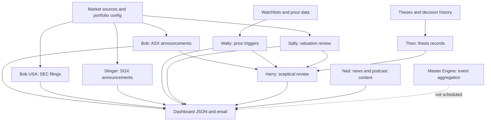

# Investing bot guide

A plain-English map of the investing agents in this repository. This guide is based on the repository's current documentation and code paths, not on assumptions about what a bot's name might mean.

## The short version

- **Bob** reads market announcements and sends the daily digest.
- **Wally** scans watchlists for shares near 52-week lows or at/below a configured target price.
- **Sunday Sally** looks for portfolio holdings that may be expensive relative to their own history, especially near 52-week highs. She recommends review, not automatic selling.
- **Harry Hindsight** is the chief sceptic. He reads the other agents' outputs and decides whether a change warrants a deeper challenge to the investment thesis.
- **Ned** gathers news and podcast-related material.
- **Theo** maintains written investment theses and records thesis changes and signals.
- **Bob USA** checks US holdings against SEC filings.
- **Slinger** handles SGX announcements.
- **Results Pack** is a focused results-document retrieval and analysis workflow.
- **Master Engine** is a proposed aggregator, not currently a production workflow.

## How they fit together

The arrows show the intended/high-level relationships. Individual workflows and data contracts are documented on each bot page. Harry is deliberately downstream: it consumes other agents' published outputs rather than replacing them.

## Individual guides

- [Bob the Bot](bob.md)
- [Wally the Watcher](wally.md)
- [Sunday Sally](sally.md)
- [Harry Hindsight](harry.md)
- [Other agents: Ned, Theo, Bob USA, Slinger, Results Pack](other-agents.md)
- [Shared infrastructure and what is actually live](infrastructure.md)

## Important status distinctions

| Status | Meaning |
|---|---|
| **Live workflow** | A GitHub Actions workflow is documented for the agent. |
| **Code exists, trigger needs checking** | Code or a README exists, but the guide does not assume the scheduled workflow is healthy. |
| **Scaffolding only** | The repository explicitly says no production workflow runs it. |
| **Not found in these repositories** | The name may exist elsewhere, but there is not enough evidence here to explain it responsibly. |

The repository's workflows and code are the source of truth for what runs. A README can lag behind code, so any conflicting details should be checked against the workflow and entry-point implementation before changing production behaviour.

## Scope note

This guide covers what I could substantiate in `JohnnyM77/Reporting-Agent-Community` and its linked architecture notes. **Micky's Macro and Shorty were not identifiable as implemented agents in the inspected documentation**, so I have not made up descriptions for them. If they live in another repository, their source needs to be inspected before adding a factual guide.
